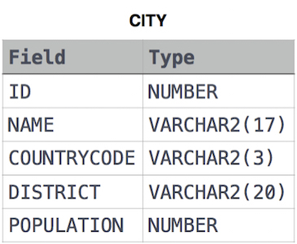

# Revising the Select Query II

```text
Query the NAME field for all American cities in the CITY table with populations larger than 120000. The CountryCode for America is USA.

The CITY table is described as follows: 
```



```sql
SELECT NAME FROM CITY WHERE CITY.POPULATION > 120000 AND CITY.COUNTRYCODE = 'USA';
```