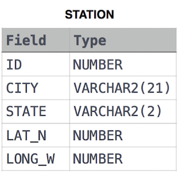

# Weather Observation Station 9

```text
Query the list of CITY names from STATION that do not start with vowels. Your result cannot contain duplicates.
```

  

```SQL
SELECT DISTINCT(CITY) FROM STATION WHERE LOWER(SUBSTRING(CITY, 1, 1)) NOT IN ('a', 'e', 'i','o','u');
```