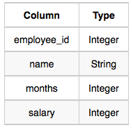

# Employee Names

```text
Write a query that prints a list of employee names (i.e.: the name attribute) from the Employee table in alphabetical order.

The Employee table is described as: 
```

  

```sql

```

